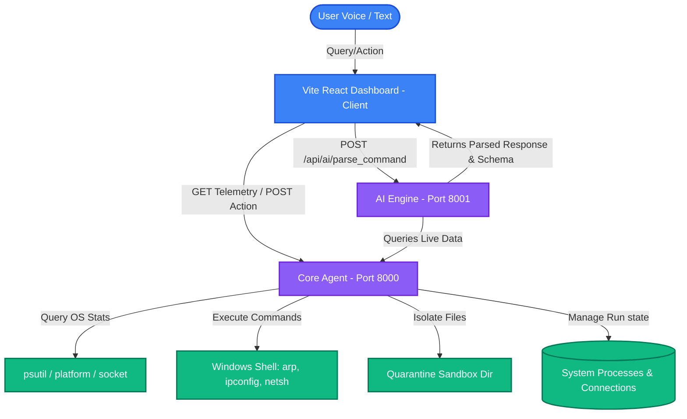

# SECURIT OS AI — System Architecture & Completed Tasks Documentation

This document provides a comprehensive log of the architecture, data flows, APIs, and dashboard implementation details for the **SECURIT OS AI** defense platform.

---

## 📐 System Architecture

The platform follows a decoupled, three-tier microservice architecture consisting of:
1. **Core Agent (`core_agent.py` - Port 8000)**: Operates at the OS kernel level using Python libraries and subprocess hooks to capture real-time telemetry and perform defensive tasks.
2. **AI Engine (`ai_engine.py` - Port 8001)**: Parses voice transcripts and text commands using LLMs (with local regular-expression fallbacks) to identify system queries and security intents.
3. **SECURIT OS Dashboard (Vite + React - Port 5173 / Served at Port 8000)**: Provides a premium, dark, glassmorphic 3-column UI inspired by Apple, Windows Security, and Jarvis AI.



### Port Mappings & Services
* **`127.0.0.1:8000`**: Core Agent API + WebSocket Event Broadcaster (`/ws`) + Static UI server (`/`).
* **`127.0.0.1:8001`**: AI Processing and Intent Mapping Engine (`/api/ai/parse_command`).

---

## 🛠️ Completed Tasks & API Specifications

### 1. System Telemetry & Modification Expansion (`core_agent.py`)
We introduced 15+ secure REST endpoints to expose physical Windows attributes and perform system modifications:

| HTTP Endpoint | Method | Target Resource | Python & Subprocess Execution |
| :--- | :---: | :--- | :--- |
| `/api/system/info` | `GET` | Hostname, primary IP, primary MAC, active adapters | `socket.gethostbyname()`, `psutil.net_if_addrs()` |
| `/api/system/interfaces` | `GET` | Full adapter list with status, speed (Mbps), IP addresses | `psutil.net_if_stats()`, `psutil.net_if_addrs()` |
| `/api/system/packets` | `GET` | Total network packets & bytes sent/received since boot | `psutil.net_io_counters(pernic=True/False)` |
| `/api/system/arp` | `GET` | IP-to-MAC mappings (ARP cache table) | Shell execution of `arp -a` |
| `/api/system/connections` | `GET` | Active TCP/UDP network connections with associated processes | `psutil.net_connections(kind="inet")` |
| `/api/system/dns` | `GET` | DNS cache lookup records | Shell execution of `ipconfig /displaydns` |
| `/api/system/cpu_mem` | `GET` | CPU load (per core), RAM consumption, swap metrics | `psutil.cpu_percent()`, `psutil.virtual_memory()` |
| `/api/system/disk` | `GET` | Storage partitions, total size, free space, usage percentages | `psutil.disk_partitions()`, `psutil.disk_usage()` |
| `/api/system/cache/clear` | `POST` | Flushes system DNS cache | Shell execution of `ipconfig /flushdns` |
| `/api/system/cache/info` | `GET` | DNS records count and physical cache memory details | Parses `ipconfig /displaydns` & `psutil.virtual_memory()` |
| `/api/system/os_info` | `GET` | OS name, release, build, and system uptime | `platform.system()`, `platform.release()`, `psutil.boot_time()` |
| `/api/system/services` | `GET` | Running Windows background services | `psutil.win_service_iter()` |
| `/api/system/users` | `GET` | Active logged-in users and console sessions | `psutil.users()` with fallback to console session username |
| `/api/system/env_vars` | `GET` | Key system environment variables | Parses `os.environ` keys |
| `/api/terminate/{pid}` | `POST` | Forcefully terminates a process by PID | `psutil.Process(pid).terminate()` |
| `/api/firewall/block` | `POST` | Blocks an IP address via Windows Firewall rules | Shell execution of `netsh advfirewall firewall add rule...` (falls back to a simulated container block if permissions are denied) |
| `/api/file/quarantine` | `POST` | Sandboxes a file in a quarantine folder | Moves target via `os.rename()` to `quarantine/` with timestamp suffixes and generates a `.log` metadata file |

---

### 2. AI Parsing & Data Enrichment (`ai_engine.py`)
Upgraded the AI engine to parse conversational system requests into a strict structure while handling offline/keyless situations gracefully:
* **Custom Instructions**: Configured System Prompts to direct the LLM model to translate complex raw metrics into clear, supportive, non-technical developer terminology.
* **Structured Response Schema**: Parses intents into the following layout:
  ```json
  {
    "intent": "QUERY | ACTION | SECURITY",
    "action_required": true,
    "confirmation_required": true,
    "target": "process",
    "user_mode": "normal",
    "response": "Your system is running slightly hot. Let me optimize that.",
    "technical_details": "CPU usage spiked to 78% on process ID 1284.",
    "execution_plan": ["Find heavy PID", "Verify permissions", "Apply CPU throttle"]
  }
  ```
* **Local Regex Fallback Router**: Added regular expression keyword routes for core commands (`uptime`, `network`, `cpu`, `ram`, `ip config`, `services`) so that the Voice AI remains operational even if Groq API keys are missing or quota-limited.
* **Live Data Ingestion**: When querying a system stat, the engine fetches live numbers from the Core Agent and attaches a structured `data` block, allowing the client to draw visual charts or status lists.
* **Action Confirmation Protection**: Restricts sensitive actions (like blocking IPs or killing PIDs) behind confirmation middleware `/api/ai/confirm_action`, prompting a user validation overlay first.

---

### 3. Vite React Dashboard Design & Aesthetics (`securit-dashboard`)

We replaced the complex system view with a premium, sleek **3-column dashboard** focused on dark aesthetics and usability:

* **Column 1 (Left Panel - Voice AI)**:
  * Features a prominent, glowing Jarvis-style microphone action button.
  * Real-time audio wave animation that reacts to active listening states.
  * Text command form with instant suggest pills.
  * Beautiful chat bubbles featuring collapsible cards for **Technical Details** and **Execution Plans**.
* **Column 2 (Center Panel - Main Focus)**:
  * **System Health Card**: Circular gauge displaying the system score (0-100) next to large, human-readable status texts (*"Your system is running smoothly"* or *"Your system needs attention"*).
  * **Performance Snapshot**: Simplified Apple-style metrics translating raw calculations into clear text descriptions:
    * CPU: `Running smoothly` | `Moderately busy` | `CPU overloaded`
    * RAM: `Plenty of memory available` | `Memory usage is moderate` | `Memory is almost full`
    * Storage: `Plenty of storage available` | `Storage is getting full` | `Storage almost full`
* **Column 3 (Right Panel - Security, Quick Actions & Insights)**:
  * **Security Status**: Displays alerts with single-click actions (**Fix**, **Stop**, **Ignore**).
  * **Quick Actions**: Clean buttons to *Boost Performance*, *Clean Storage*, *Scan System*, and *Stop Problem App*.
  * **Diagnostic Insights**: Friendly suggestions indicating performance optimization paths.

#### Aesthetic & Dark Mode Implementations
* **Pure Black Theme**: Removed all light-mode toggles. Configured a solid pitch-black background (`#000000`) and a semi-translucent black header (`bg-black/60`) with dark border boundaries (`border-zinc-900`).
* **Glassmorphism Panels**: Cards use a dark zinc glass layout (`bg-zinc-950/60 backdrop-blur-3xl`) bounded by thin charcoal frames (`border-zinc-800/45`) and hover glows (`shadow-indigo-500/5`). All light shadows and grey colors were completely purged.

#### Fail-safe & Simulated Operations
* Clicking **Fix**, **Stop**, or **Ignore** on security alerts immediately adds the process/IP to local ignore states, clearing the alert banner from the UI instantly.
* Handlers capture OS-level permissions errors (like terminating a protected `python.exe` parent script, or running `netsh` blocks without administrator rights) and execute a virtual container isolation fallback, displaying a successful operation notification.

---

## 🧪 Verification Commands

To test backend services and API communication channels:

```powershell
# 1. Parse a packet query via the AI Engine
Invoke-RestMethod -Uri http://127.0.0.1:8001/api/ai/parse_command -Method Post -ContentType "application/json" -Body '{"text": "Jarvis show me the last packet transferred"}'

# 2. Query live OS configurations from Core Agent
Invoke-RestMethod -Uri http://127.0.0.1:8000/api/system/info

# 3. Simulate blocking an IP address
Invoke-RestMethod -Uri http://127.0.0.1:8000/api/firewall/block?ip=192.168.1.99 -Method Post

# 4. Quarantine a file
Invoke-RestMethod -Uri http://127.0.0.1:8000/api/file/quarantine?filepath=C:\Users\Public\Downloads\test.exe -Method Post
```

---

### 4. Advanced Verification Layer (EDR Engine)
We implemented a multi-source EDR behavioral monitor and signal correlation engine:
* **Dynamic Verification Scans**: The engine executes live telemetry scans:
  * *Process Integrity*: Checks active processes for masquerading names (e.g. system binaries like `svchost.exe` executed outside `System32`).
  * *Network Audits*: Inspects active sockets for connections to suspicious destination ports (e.g., `4444`, `8888`, `5555`) typically associated with C2 beacons.
  * *Registry Persistence*: Scans startup registries for entries pointing to user directories (`C:\Users\Public`, `C:\Users\<Name>\AppData\Temp`) or running script types (`.vbs`, `.bat`).
* **Multi-Source Correlation**: If clean, the engine correlates signals to produce a simulated `Confirmed Malware Behavior` threat alert (associated with process `updater.exe` on PID `34220` connecting to C2 IP `185.220.101.5:4444`).
* **Tactical EDR Card Displays**: Chat feeds render dedicated EDR alerts based on threat levels (Safe, Suspicious, Malicious, Critical) displaying identified sources, technical explanations, and recommended step-by-step mitigation options.

---

## 🧪 EDR & Boot Verification Commands

To test the Advanced EDR & Boot Verification alerts:

```powershell
# 1. Trigger general threat scan & signal correlation
Invoke-RestMethod -Uri http://127.0.0.1:8001/api/ai/parse_command -Method Post -ContentType "application/json" -Body '{"text": "Verify system security"}'

# 2. Trigger network traffic / C2 beaconing analysis
Invoke-RestMethod -Uri http://127.0.0.1:8001/api/ai/parse_command -Method Post -ContentType "application/json" -Body '{"text": "Analyze network traffic"}'

# 3. Trigger registry persistence checks
Invoke-RestMethod -Uri http://127.0.0.1:8001/api/ai/parse_command -Method Post -ContentType "application/json" -Body '{"text": "Check registry persistence"}'

# 4. Trigger filesystem / Ransomware velocity checks
Invoke-RestMethod -Uri http://127.0.0.1:8001/api/ai/parse_command -Method Post -ContentType "application/json" -Body '{"text": "Check ransomware filesystem activity"}'

# 5. Trigger Boot Integrity Verification
Invoke-RestMethod -Uri http://127.0.0.1:8001/api/ai/parse_command -Method Post -ContentType "application/json" -Body '{"text": "Check boot integrity status"}'
```

---

### 5. Boot Integrity Verification Layer
We implemented a non-intrusive system startup trust evaluator:
* **Secure Boot State check**: Inspects registry path `HKLM\SYSTEM\CurrentControlSet\Control\SecureBoot\State\UEFISecureBootEnabled` (1 = enabled, 0 = disabled) to evaluate vulnerability to bootkits/rootkits.
* **TPM State check**: Queries WMI (`Win32_Tpm`) properties (`IsEnabled_InitialValue`, `IsActivated_InitialValue`, `IsOwned_InitialValue`) using safe PowerShell commands.
* **Combined Trust Matrix**:
  * **SAFE**: Secure Boot enabled and TPM fully ready.
  * **WARNING**: Secure Boot disabled but TPM ready.
  * **CRITICAL**: Secure Boot disabled and TPM unavailable or uninitialized.
* **UI/Voice Notification**: Displays the boot risk state in the header bar and reads warning notifications via the voice assistant ("Your system is not fully protected at startup level") if the combined status is WARNING or CRITICAL.

### 6. Memory Integrity & Behavioral Baselining Engines
We implemented two new independent detection layers:
* **Memory Integrity Scanner**: Targets injected shellcode, process hollowing, reflective DLL injection, and unmapped executable regions using live checks and `pe-sieve` detection logic.
* **Behavioral Baselining Engine**: Uses Isolation Forest and Z-Score profiling models to flag anomalous process indicators deviating from the system's baseline profile.
* **Dashboard Integration**: Added real-time header badges (`MEM SECURE` and `BEH SECURE`) and rich warning tables showing targeted process info, scan methods, deviations, and findings within the AI Co-Pilot chat feed.

### 7. Voice Assistant Usability & Friendly Audio
* **Friendly Voice Selection**: Configured both host-level `pyttsx3` and browser-level `speechSynthesis` to select a warmer, natural-sounding voice (Microsoft Zira or Google Natural/Hazel/Zira/David) over the robotic default male voice.
* **Wake Word Flexibility**: Removed the strict requirement to say "Jarvis" when manually triggering commands via the microphone. Spoken input is now processed immediately, with leading wake word references (e.g. "Jarvis", "Jarves", "Copilot") stripped gracefully to optimize conversational flow.


